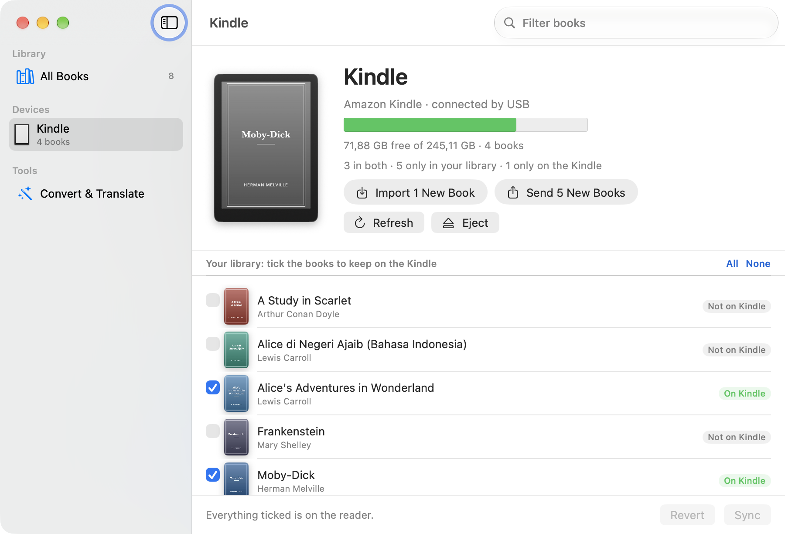
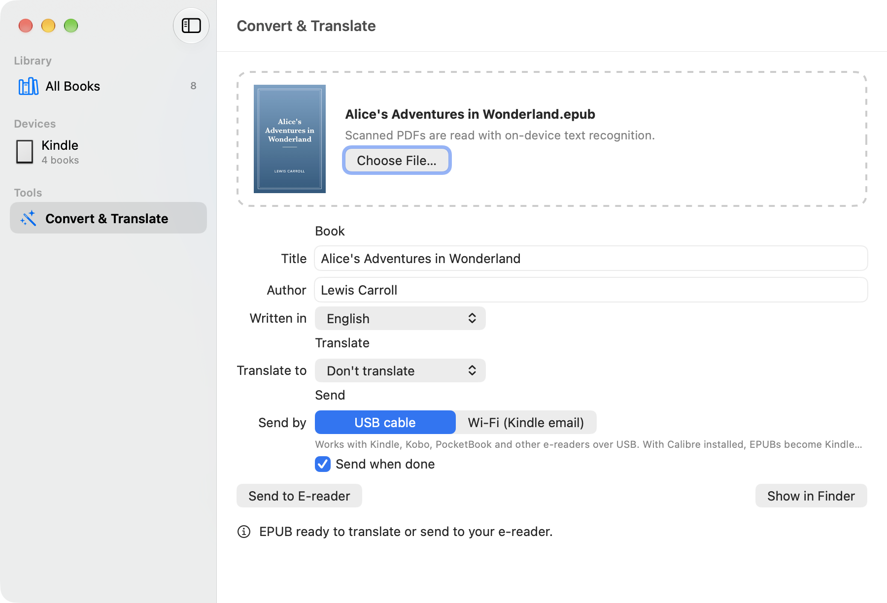

# Book Forge

An e-book library app for **Mac, Windows and Linux**. It reads EPUBs and PDFs, turns PDF books into clean EPUBs, translates whole books between **eight languages**, and syncs them to a Kindle or other e-reader over USB. No other software is needed.

Languages: Indonesian, English, Japanese, Korean, Chinese (Simplified), Chinese (Traditional), Thai and Vietnamese.

## Screenshots

**Library:** your EPUBs and PDFs with their covers. A green tick marks books that are on the connected e-reader.


**E-reader:** plug in a Kindle, Kobo or other reader to see what's on it, sync with ticks, or import and send new books in one click.



**Convert & Translate:** turn a PDF into an EPUB, translate it into another language, and send it to your reader.



*Shown with a demo library of public-domain classics; the Mac app is pictured.*

## What it does

- **Library.** Keeps your EPUBs and PDFs in one place (`Documents/Book Forge Library`) with their covers, reading progress, search and sorting. Drag in files or whole folders; books you make or translate are added automatically.
- **Built-in reader.** Double-click a book to read it. EPUBs turn pages like an e-reader: one or two pages, arrow keys, clicks, swipes, contents, text size, fonts and light, sepia or dark themes. Vertical Japanese books read right to left. Book Forge remembers where you stopped.
- **E-readers over USB.** Plug in a Kindle, Kobo, PocketBook, Boox or other e-reader and it appears in the sidebar with its name, a drawing of the device, free space and the books on it. Newer Kindles and Boox readers, which connect by MTP rather than as a drive, work too.
  - **Sync:** tick the library books you want on the reader and press **Sync**. Missing ones are copied and unticked ones are removed. Books bought from the store stay unless you untick them.
  - **Import:** books that are only on the reader can be copied into the library. EPUBs and PDFs come over as they are; Kindle books (AZW3, MOBI) are converted to EPUB. Store books locked with DRM (and Amazon's KFX format) can't be copied.
- **One-click Import and Send.** **Import New Books** copies every book that's only on the reader into the library; **Send New Books** copies every library book the reader doesn't have yet. Nothing is removed and nothing is copied twice:
  - books are recognised by the ID Book Forge gives them and by title (ignoring case, accents and punctuation);
  - only one copy of each title is taken (EPUB before Kindle formats before PDF);
  - Kindle Store books are left on the reader.

  The device screen counts the books in both places, only in the library and only on the reader, and labels each one **On Kindle**, **Not on Kindle** or **Not in library**. In the library, a green tick marks books on the connected reader and a grey tick books that were on it last time.
- **PDF → EPUB.** Uses the PDF's text layer when it has one, otherwise reads scanned pages with text recognition. It rebuilds chapters, paragraphs, scene breaks and drop caps, removes running heads and page numbers, and keeps the cover and any image pages. Chapter titles are found in every supported language, including those without capital letters (Chinese, Japanese, Korean, Thai).
- **Translate a book.** Translates a whole EPUB between any two of the eight languages, keeping italics, bold, links, images and the table of contents. The translated copy is marked with its new language (so e-readers pick the right Chinese, Japanese or Thai fonts) and its title gets the language name, such as "(Tiếng Việt)" or "(繁體中文)", so it doesn't replace the original on your reader.
  - **Claude** (needs an Anthropic API key): reads passages from across the book first and writes a style sheet (the narrator's voice, how each character speaks, fixed spellings for names and titles). It then translates with guidance for each language: slang and particles, honorifics and forms of address, politeness levels (Korean speech levels, Japanese keigo, Thai polite particles, Vietnamese pronoun pairs), dialogue punctuation, and how to write foreign names. The app shows a cost estimate and asks before sending anything (roughly $2–5 for a novel).
  - **Apple Translate** (Mac only): free and offline, but literal.
- **Kindle by Wi-Fi.** Emails a book to your Kindle's `@kindle.com` address: through the Mail app on the Mac, or through your mail server (for example Gmail with an app password) on Windows and Linux. Add your sending address to the approved list in your Amazon account first.

## Requirements

- **Mac:** macOS 26 on Apple silicon.
- **Windows:** Windows 10 or 11, 64-bit.
- **Linux:** a 64-bit desktop distribution (built on Ubuntu 22.04). For MTP readers such as newer Kindles, the system's libmtp (package `libmtp9` or `libmtp`), which desktop distributions already have.

Optional:

- [Calibre](https://calibre-ebook.com), only to turn EPUBs into Kindle books (so they appear in the Kindle's own library with covers) and to import Kindle-format books as EPUB. Without it, Book Forge sends EPUBs to readers that open them (Kobo, PocketBook, Boox, and Kindles running KOReader) and PDFs to any reader. Email to Kindle converts EPUBs too.
- For scanned PDFs on Windows and Linux: [Tesseract OCR](https://github.com/tesseract-ocr/tesseract) with the languages your books are in. The Mac uses Apple's built-in text recognition.
- For Claude translation: an API key from [console.anthropic.com](https://console.anthropic.com). The book's text is sent to Anthropic for translation. The key is kept in the macOS Keychain, Windows Credential Manager or your Linux keyring.
- For Apple translation: the language pair downloaded under System Settings → General → Language & Region → Translation Languages.

## Install

Download from the [latest release](../../releases/latest):

- **Mac:** `Book-Forge.zip`. Unzip it and move **Book Forge** to Applications. The app is not notarized, so the first time macOS refuses to open it: right-click it and choose **Open**, or go to System Settings → Privacy & Security and click **Open Anyway**. Or remove the quarantine flag:

  ```bash
  xattr -dr com.apple.quarantine "/Applications/Book Forge.app"
  ```

- **Windows:** `Book-Forge-Windows.zip`. Unzip the folder somewhere it can stay, then double-click **Install.cmd** (adds Book Forge to the Start menu and desktop), or just double-click **Book Forge.exe**. Windows may warn that the app is from an unknown publisher: choose **More info → Run anyway**.
- **Linux:** `Book-Forge-Linux.tar.gz`. Unpack it somewhere it can stay and run `./install.sh` (adds Book Forge to your applications menu), or start it with `./book-forge`.

## Build from source

**Mac:** no Xcode project is needed, only the command-line tools:

```bash
./build.sh            # builds build/Book Forge.app
./build.sh --install  # also copies it to /Applications
```

**Windows and Linux:** the app in [`windows-linux/`](windows-linux) is Python and Qt (PySide6), packaged with PyInstaller. Run `windows-linux/build-windows.cmd` on Windows or `windows-linux/build-linux.sh` on Linux. GitHub Actions builds and checks both on every push to a branch named `build-*` (see [`.github/workflows`](.github/workflows)). To run it from source: `pip install -r windows-linux/requirements.txt`, then `python windows-linux/run.py`.

The language list, with each language's translation notes, is shared by all three apps in [`Resources/languages.json`](Resources/languages.json).

## Command-line modes

The apps also run without a window, which is handy for testing. On the Mac the binary is `Book Forge.app/Contents/MacOS/BookForge`; on Windows and Linux use `python run.py` from `windows-linux/`.

```bash
BookForge --convert book.pdf book.epub [id|en|ja|ko|zh-Hans|zh-Hant|th|vi]
BookForge --device       # show what's on the connected e-reader
BookForge --plan         # show what Import and Send would copy, without copying
BookForge --import-new   # copy books only on the e-reader into the library
BookForge --send-new     # copy library books the e-reader doesn't have
```

The Mac app also has `--translate in.epub out.epub <from> <to> [apple|claude]` (the key comes from `ANTHROPIC_API_KEY` or the Keychain) and `--send book.epub`.

## Notes

Only convert and translate books you own, for your own reading.

Third-party software included in the apps, and its licenses, is listed in [`windows-linux/THIRD-PARTY.md`](windows-linux/THIRD-PARTY.md).
